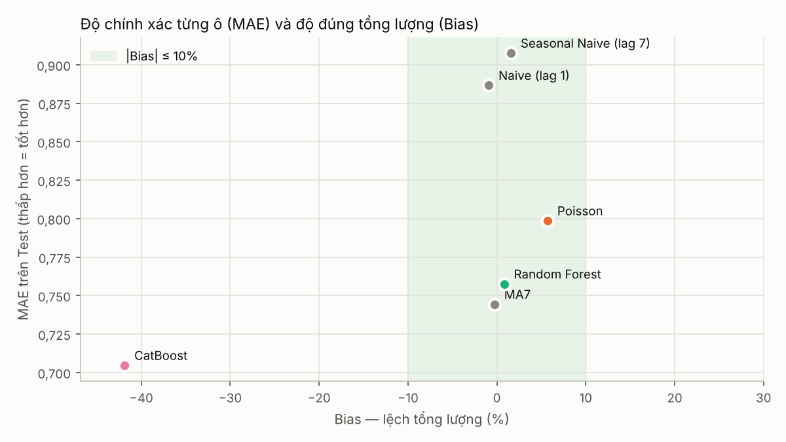
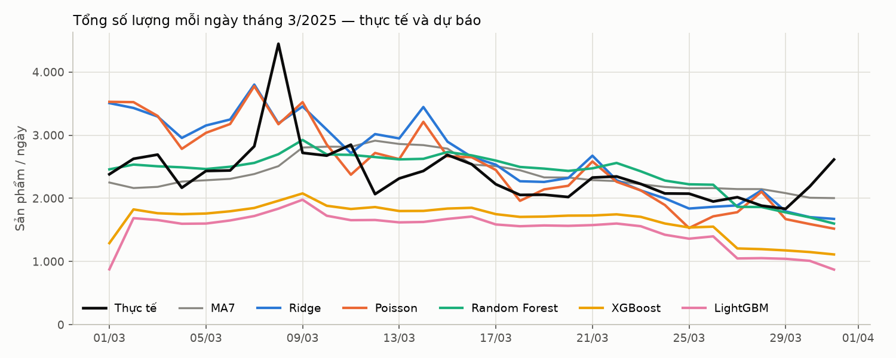

# Kết quả dự báo lượng bán — so sánh mô hình

Dự báo `so_luong` (số sản phẩm bán) mỗi ngày cho từng cặp **cửa hàng × nhóm hàng** của chuỗi Genbyte, Q1/2025. Ba baseline và năm mô hình học máy (Ridge, Poisson, Random Forest, XGBoost, LightGBM) dùng **cùng bảng, cùng đặc trưng, cùng mốc chia, cùng hàm chấm điểm**: tối ưu trên Validation 15–28/02, train lại trên 15/01–28/02, chấm trên Test tháng 3.

> 🔄 Bảng, biểu đồ và nhận định tự động được sinh lại bằng `python module5/tao_bao_cao.py` từ `bao_cao/du_lieu/` — **không sửa tay các khối này** (bị ghi đè mỗi lần chạy). Phần viết tay: *Cách đọc chỉ số*, ghi chú ở mục 3, 8, 9 và *Kết luận và khuyến nghị*. Cách nộp kết quả một mô hình: [README → Nộp kết quả vào báo cáo](../README.md#nộp-kết-quả-vào-báo-cáo).

<!-- TU_DONG:trang_thai -->
> **Cập nhật tự động 12/10/2026 09:56** · Test 01/03–31/03/2025: 67.146 ô, tổng thực tế 74.196 sản phẩm · bảng mô hình tổng 216.592 sản phẩm — giữ: bán buôn, khu vực Khác, trả lại; bỏ: không
>
> **Đã nộp 5/5:** ✅ Ridge · ✅ Poisson · ✅ Random Forest · ✅ XGBoost · ✅ LightGBM
> **Kiểm tra so sánh công bằng:** ✔ cùng bảng, cùng tập Test, cùng baseline
<!-- /TU_DONG -->

## 1. Tóm tắt

<!-- TU_DONG:tom_tat -->
- **MAE thấp nhất:** LightGBM 0,678 (MA7 0,744) · **WAPE thấp nhất:** LightGBM 0,614 (MA7 0,674).
- **RMSE thấp nhất:** Random Forest 4,743 (MA7 4,975) · **R² cao nhất:** Random Forest 0,423 (MA7 0,365).
- **Thắng MA7 về MAE:** XGBoost, LightGBM · **thua MA7:** Ridge (MAE +7,7%), Poisson (MAE +7,3%), Random Forest (MAE +1,8%).
- **Lệch tổng lượng quá 10% (|Bias|):** Ridge (+10,7%), XGBoost (−30,5%), LightGBM (−37,3%).
- **Theo tiêu chí đề xuất (MAE thấp nhất trong các mô hình có |Bias| ≤ 10%):** **MA7** — chưa mô hình học máy nào vượt MA7 khi xét cả tổng lượng.
<!-- /TU_DONG -->

## 2. So sánh trên tập Test

<!-- TU_DONG:bang_test -->
| Mô hình | MAE | RMSE | WAPE | R² | Bias | WAPE so với MA7 | WAPE < MA7 (nhóm hàng · cửa hàng) |
|---|---:|---:|---:|---:|---:|---:|---:|
| Naive (lag 1) | 0,887 | 6,675 | 0,802 | −0,142 | −0,9% | +19,1% | — |
| Seasonal Naive (lag 7) | 0,908 | 6,728 | 0,821 | −0,160 | +1,6% | +21,9% | — |
| MA7 | 0,744 | 4,975 | 0,674 | 0,365 | **−0,2%** | — | — |
| **Ridge** | 0,802 | 4,984 | 0,725 | 0,363 | +10,7% ⚠️ | +7,7% | 2/23 · 12/130 |
| **Poisson** | 0,799 | 5,196 | 0,723 | 0,308 | +5,7% | +7,3% | 6/23 · 33/130 |
| **Random Forest** | 0,757 | **4,743** | 0,686 | **0,423** | +0,8% | +1,8% | 4/23 · 22/130 |
| **XGBoost** | 0,700 | 5,527 | 0,634 | 0,217 | −30,5% ⚠️ | −5,9% | 22/23 · 124/130 |
| **LightGBM** | **0,678** | 5,478 | **0,614** | 0,231 | −37,3% ⚠️ | −8,9% | 22/23 · 124/130 |

In đậm = tốt nhất mỗi cột · ⚠️ = lệch tổng lượng quá 10%.

<!-- /TU_DONG -->

**Cách đọc chỉ số**

| Chỉ số | Ý nghĩa | Tốt khi |
|---|---|---|
| MAE | Sai số tuyệt đối trung bình mỗi ô (sản phẩm/ô/ngày) | Thấp |
| RMSE | Như MAE nhưng phạt nặng sai số lớn — nhạy với ô bán buôn đột biến | Thấp |
| WAPE | Tổng sai số tuyệt đối / tổng lượng bán thực tế | Thấp |
| R² | Phần biến động giải thích được so với đoán mọi ô bằng trung bình; < 0 là tệ hơn trung bình | Cao |
| Bias | Tổng dự báo / tổng thực tế − 1; âm = dự báo thiếu hàng | Gần 0 |

Baseline: **Naive** = lượng bán hôm qua (`lag_1`) · **Seasonal Naive** = cùng thứ tuần trước (`lag_7`) · **MA7** = trung bình 7 ngày trước (`tb_7`). MA7 là mốc chính: một mô hình chỉ có giá trị khi tốt hơn MA7.

## 3. Chọn mô hình

<!-- TU_DONG:chon_mo_hinh -->
| Tiêu chí | Tốt nhất (gồm baseline) | Mô hình học máy tốt nhất | Hơn MA7? |
|---|---|---|---:|
| MAE thấp nhất | LightGBM (0,678) | LightGBM (0,678) | ✔ |
| WAPE thấp nhất | LightGBM (0,614) | LightGBM (0,614) | ✔ |
| RMSE thấp nhất | Random Forest (4,743) | Random Forest (4,743) | ✔ |
| R² cao nhất | Random Forest (0,423) | Random Forest (0,423) | ✔ |
| \|Bias\| nhỏ nhất (đúng tổng lượng) | MA7 (−0,2%) | Random Forest (+0,8%) | ✘ |
| **MAE thấp nhất trong các mô hình có \|Bias\| ≤ 10% (đề xuất)** | **MA7** (0,744) | Random Forest (0,757) | ✘ |
<!-- /TU_DONG -->

*Ghi chú:* tiêu chí chính thức **chưa chốt**. Với dữ liệu thưa (≈ 70% ô bằng 0), chọn chỉ theo MAE/WAPE sẽ ưu tiên mô hình dự báo gần 0 và thiếu hàng hệ thống. Đề xuất: chọn MAE thấp nhất trong các mô hình có |Bias| ≤ 10%.

## 4. Tối ưu tham số: Validation → Test

<!-- TU_DONG:validation -->
| Mô hình | Cấu hình chọn | Số cấu hình thử | MAE Val | MA7 Val | MAE Test | MA7 Test | So với MA7: Val → Test |
|---|---|---:|---:|---:|---:|---:|---:|
| Ridge | `alpha=100.0, bien_doi=goc, one_hot=['thu', 'Mã cửa hàng_code', 'Nhóm hàng_code', 'Vùng_code'], chuan_hoa=['lag_1', 'lag_7', 'lag_14', 'tb_7', 'tb_14', 'std_7', 'std_14', 'cuoi_tuan', 'ngay_trong_thang', 'ngay_toi_tet']` | 12 | 0,753 | 0,847 | 0,802 | 0,744 | ✔ thắng → ✘ thua |
| Poisson | `alpha=1e-05, bien_doi=log1p, max_iter=2000, one_hot=['thu', 'Mã cửa hàng_code', 'Nhóm hàng_code', 'Vùng_code'], chuan_hoa=['lag_1', 'lag_7', 'lag_14', 'tb_7', 'tb_14', 'std_7', 'std_14', 'cuoi_tuan', 'ngay_trong_thang', 'ngay_toi_tet']` | 12 | 0,771 | 0,847 | 0,799 | 0,744 | ✔ thắng → ✘ thua |
| Random Forest | `n_estimators=300, min_samples_leaf=20, max_features=sqrt, max_depth=8, criterion=squared_error` | 12 | 0,868 | 0,847 | 0,757 | 0,744 | ✘ thua → ✘ thua |
| XGBoost | `objective=reg:absoluteerror, eval_metric=mae, reg_lambda=1.0, min_child_weight=20, max_depth=4, learning_rate=0.03, subsample=0.8, colsample_bytree=0.8, tree_method=hist, n_estimators=179, early_stopping_rounds=75` | 12 | 0,753 | 0,847 | 0,700 | 0,744 | ✔ thắng → ✔ thắng |
| LightGBM | `objective=regression_l1, metric=l1, reg_lambda=3, num_leaves=31, min_child_samples=100, learning_rate=0.03, n_estimators=153` | 12 | 0,741 | 0,847 | 0,678 | 0,744 | ✔ thắng → ✔ thắng |

- ⚠️ Ridge thắng MA7 trên Validation nhưng thua trên Test — Validation chưa đại diện cho Test.
- ⚠️ Poisson thắng MA7 trên Validation nhưng thua trên Test — Validation chưa đại diện cho Test.
<!-- /TU_DONG -->

## 5. Tổng lượng dự báo

<!-- TU_DONG:tong_luong -->

**Tổng lượng (sản phẩm), chia theo lượng bán thực tế của ô:**

| Tổng lượng | Thực tế | MA7 | Ridge | Poisson | Random Forest | XGBoost | LightGBM |
|---|---:|---:|---:|---:|---:|---:|---:|
| Trung bình / ngày toàn hệ thống | 2.393 | 2.388 | 2.650 | 2.530 | 2.413 | 1.663 | 1.500 |
| Ô bán 0 (46.477 ô) | 0 | 11.195 | 16.295 | 12.224 | 13.297 | 6.864 | 3.649 |
| Ô bán 1–4 (16.489 ô) | 28.742 | 25.901 | 28.613 | 24.879 | 25.906 | 20.142 | 17.485 |
| Ô bán 5–19 (3.902 ô) | 31.884 | 26.013 | 27.439 | 28.644 | 24.990 | 20.285 | 20.771 |
| Ô bán ≥ 20 (278 ô) | 13.570 | 10.904 | 9.810 | 12.695 | 10.622 | 4.250 | 4.589 |

**MAE theo quy mô ô** (in đậm = tốt nhất mỗi dòng):

| Quy mô ô | MA7 | Ridge | Poisson | Random Forest | XGBoost | LightGBM |
|---|---:|---:|---:|---:|---:|---:|
| Ô bán 0 | 0,241 | 0,351 | 0,263 | 0,286 | 0,148 | **0,079** |
| Ô bán 1–4 | 1,092 | 1,111 | 1,120 | **1,050** | 1,051 | 1,161 |
| Ô bán 5–19 | 3,164 | **2,943** | 3,524 | 3,092 | 3,458 | 3,515 |
| Ô bán ≥ 20 | 30,331 | **27,807** | 33,016 | 29,468 | 33,530 | 32,428 |

- **Ridge** tốt hơn MA7 ở ô 5–19, ≥ 20; kém hơn ở ô 0, 1–4. Ô bán ≥ 20: dự báo 9.810 so với thực tế 13.570 (MA7 10.904).
- **Poisson** tốt hơn MA7 ở ô —; kém hơn ở ô 0, 1–4, 5–19, ≥ 20. Ô bán ≥ 20: dự báo 12.695 so với thực tế 13.570 (MA7 10.904).
- **Random Forest** tốt hơn MA7 ở ô 1–4, 5–19, ≥ 20; kém hơn ở ô 0. Ô bán ≥ 20: dự báo 10.622 so với thực tế 13.570 (MA7 10.904).
- **XGBoost** tốt hơn MA7 ở ô 0, 1–4; kém hơn ở ô 5–19, ≥ 20. Ô bán ≥ 20: dự báo 4.250 so với thực tế 13.570 (MA7 10.904).
- **LightGBM** tốt hơn MA7 ở ô 0; kém hơn ở ô 1–4, 5–19, ≥ 20. Ô bán ≥ 20: dự báo 4.589 so với thực tế 13.570 (MA7 10.904).
<!-- /TU_DONG -->

## 6. Theo nhóm hàng

<!-- TU_DONG:nhom_hang -->
| Nhóm hàng | Thực tế | MA7 | Ridge | Poisson | Random Forest | XGBoost | LightGBM |
|---|---:|---:|---:|---:|---:|---:|---:|
| Điện thoại | 24.577 | 0,559 | 0,538 | 0,600 | **0,533** | 0,547 | 0,541 |
| Phụ kiện | 19.610 | 0,507 | 0,500 | 0,556 | **0,498** | 0,516 | 0,513 |
| Hcare (bảo hành) | 12.288 | 0,552 | 0,562 | 0,584 | 0,547 | **0,531** | 0,538 |
| Tai nghe | 3.663 | 0,845 | 0,860 | 0,882 | 0,841 | 0,797 | **0,775** |
| Màn hình | 2.473 | 0,940 | 0,990 | 1,027 | 0,956 | 0,844 | **0,806** |
| Máy tính bảng | 2.343 | 1,112 | 1,185 | 1,145 | 1,130 | 0,981 | **0,905** |
| Đồng hồ | 2.211 | 1,020 | 1,073 | 1,089 | 1,064 | 0,921 | **0,846** |
| Laptop | 1.516 | 1,258 | 1,355 | 1,256 | 1,279 | 1,077 | **0,965** |
| 15 nhóm hàng còn lại | 5.515 | 1,331 | 2,015 | 1,457 | 1,614 | 1,079 | **0,953** |
| **Thắng MA7** |  |  | 2/23 | 6/23 | 4/23 | 22/23 | 22/23 |

Giá trị là WAPE (thấp hơn = tốt hơn), in đậm = tốt nhất mỗi dòng · *Thắng MA7* = số nhóm hàng có WAPE thấp hơn MA7.

- **Ridge** thắng MA7 ở 2/23 nhóm, chiếm 60% lượng bán; Điện thoại 0,538 vs 0,559 ✔, Phụ kiện 0,500 vs 0,507 ✔, Hcare (bảo hành) 0,562 vs 0,552 ✘.
- **Poisson** thắng MA7 ở 6/23 nhóm, chiếm 4% lượng bán; Điện thoại 0,600 vs 0,559 ✘, Phụ kiện 0,556 vs 0,507 ✘, Hcare (bảo hành) 0,584 vs 0,552 ✘.
- **Random Forest** thắng MA7 ở 4/23 nhóm, chiếm 81% lượng bán; Điện thoại 0,533 vs 0,559 ✔, Phụ kiện 0,498 vs 0,507 ✔, Hcare (bảo hành) 0,547 vs 0,552 ✔.
- **XGBoost** thắng MA7 ở 22/23 nhóm, chiếm 74% lượng bán; Điện thoại 0,547 vs 0,559 ✔, Phụ kiện 0,516 vs 0,507 ✘, Hcare (bảo hành) 0,531 vs 0,552 ✔.
- **LightGBM** thắng MA7 ở 22/23 nhóm, chiếm 74% lượng bán; Điện thoại 0,541 vs 0,559 ✔, Phụ kiện 0,513 vs 0,507 ✘, Hcare (bảo hành) 0,538 vs 0,552 ✔.
<!-- /TU_DONG -->

## 7. Theo khu vực

<!-- TU_DONG:khu_vuc -->
| Khu vực | Thực tế | MA7 | Ridge | Poisson | Random Forest | XGBoost | LightGBM |
|---|---:|---:|---:|---:|---:|---:|---:|
| KVHN2 | 12.430 | 0,551 | 0,565 | 0,564 | 0,556 | 0,549 | **0,528** |
| KVHN1 | 12.183 | 0,519 | 0,528 | 0,526 | 0,515 | 0,496 | **0,489** |
| Khác - Online | 9.927 | 0,769 | 0,825 | 0,985 | 0,739 | 0,744 | **0,733** |
| KVHN3 | 8.521 | 0,540 | 0,576 | 0,568 | 0,540 | 0,515 | **0,507** |
| KVMB1 | 4.518 | 0,790 | 0,898 | 0,834 | 0,834 | 0,714 | **0,682** |
| KVMB2 | 3.637 | 0,754 | 0,840 | 0,794 | 0,783 | 0,698 | **0,665** |
| KVMTR3 | 3.331 | 0,791 | 0,885 | 0,837 | 0,827 | 0,727 | **0,689** |
| KVMTR1 | 3.223 | 0,752 | 0,809 | 0,775 | 0,770 | 0,680 | **0,655** |
| KVMN2 | 3.052 | 0,711 | 0,808 | 0,791 | 0,748 | 0,654 | **0,626** |
| KVHCM1 | 2.999 | 0,838 | 0,924 | 0,849 | 0,887 | 0,757 | **0,725** |
| KVMTR2 | 2.823 | 0,695 | 0,780 | 0,740 | 0,732 | 0,655 | **0,636** |
| KVHCM2 | 2.704 | 0,886 | 0,944 | 0,883 | 0,925 | 0,791 | **0,761** |
| KVMN1 | 2.415 | 0,840 | 0,922 | 0,827 | 0,877 | 0,754 | **0,720** |
| KVMN3 | 2.022 | 0,882 | 0,975 | 0,892 | 0,937 | 0,792 | **0,762** |
| Khác - Dịch vụ sửa chữa | 411 | 0,830 | 0,994 | 0,970 | 0,866 | 0,749 | **0,714** |
| **Thắng MA7** |  |  | 0/15 | 2/15 | 2/15 | 15/15 | 15/15 |

Giá trị là WAPE (thấp hơn = tốt hơn), in đậm = tốt nhất mỗi dòng · *Thắng MA7* = số khu vực có WAPE thấp hơn MA7.
<!-- /TU_DONG -->

## 8. Đặc trưng quan trọng

<!-- TU_DONG:dac_trung -->
| Nhóm đặc trưng | Ridge | Poisson | Random Forest | XGBoost | LightGBM |
|---|---:|---:|---:|---:|---:|
| Bán gần đây (lag, trung bình, độ lệch chuẩn) | 90% | 25% | 96% | 86% | 31% |
| Lịch (thứ, cuối tuần, ngày trong tháng, Tết) | 4% | 12% | 3% | 9% | 19% |
| Mã cửa hàng / nhóm hàng / vùng | 6% | 63% | 1% | 5% | 50% |
| Top 3 đặc trưng | `tb_7` 33,8% `std_7` 16,0% `tb_14` 13,5% | `Nhóm hàng_code` 43,6% `Mã cửa hàng_code` 10,3% `Vùng_code` 8,8% | `tb_14` 21,3% `tb_7` 20,1% `std_14` 16,1% | `lag_1` 39,8% `tb_14` 20,4% `tb_7` 17,3% | `Mã cửa hàng_code` 30,8% `tb_14` 20,0% `Nhóm hàng_code` 19,6% |

Tỷ trọng mức quan trọng (Ridge/Poisson: trị tuyệt đối hệ số trên đặc trưng chuẩn hoá), mỗi cột cộng lại 100%.
<!-- /TU_DONG -->

*Ghi chú:* `tb_7`, `tb_14` là lượng bán trung bình 7 / 14 ngày liền trước (ngày không bán tính là 0); `std_7`, `std_14` là độ lệch chuẩn trên cùng cửa sổ; `lag_k` là lượng bán k ngày trước. Mọi đặc trưng chỉ dùng quá khứ (dời ≥ 1 ngày).

## 9. R² âm và bộ lọc giao dịch

<!-- TU_DONG:r2 -->
R² = 1 − (tổng bình phương sai số) / (tổng bình phương độ lệch so với trung bình Test). **R² < 0 nghĩa là dự báo tệ hơn việc đoán mọi ô bằng trung bình tập Test** — không phải lỗi tính, và không cắt về 0.

| Có R² âm | R² | 10 ô sai nhiều nhất chiếm | Cửa hàng chiếm nhiều nhất |
|---|---:|---:|---:|
| Naive (lag 1) | −0,142 | 79% | HN007 (76%) |
| Seasonal Naive (lag 7) | −0,160 | 81% | HN007 (79%) |
<!-- /TU_DONG -->

*Ghi chú (viết tay, phân tích ngày 09/10/2026):* phần lớn sai số này đến từ **đơn bán buôn** — một ngày đơn lớn ở HN007 bị Naive lặp sang hôm sau thành hai sai số lớn. Bỏ bán buôn khỏi biến mục tiêu (`tao_bang_ngay(..., bo_ban_buon=True)`) thì R² của cả 3 baseline trên Test đều dương; đây là quyết định chung của nhóm, **chưa áp dụng**:

| Bảng mô hình | Naive | Seasonal Naive | MA7 | Ô lớn nhất trên Test |
|---|---:|---:|---:|---:|
| Giữ tất cả (hiện tại) | −0,142 | −0,160 | 0,365 | 798 |
| **Bỏ bán buôn** | **0,496** | **0,529** | **0,700** | 207 |
| Bỏ khu vực Khác | 0,326 | 0,315 | 0,495 | 456 |
| Bỏ bán buôn + khu vực Khác | 0,485 | 0,476 | 0,688 | 207 |

## 10. Nhận xét của từng module

<!-- TU_DONG:nhan_xet -->

<b>Module 1 · Ridge</b> — trích mục 5 của <code>module1/Module1_ridge.ipynb</code> (chạy 12/10/2026)

**Thảo luận.**

1. **Ridge thua MA7 trên mọi chỉ số Test.** MAE 0,802 so với 0,744, WAPE 0,725 so với 0,674 (kém 7,6%), RMSE 4,984 so với 4,975, R² 0,363 so với 0,365. Trên Validation Ridge lại thắng MA7 rõ (MAE 0,753 so với 0,847): Validation 15–28/02 là giai đoạn phục hồi sau Tết, không đại diện cho tháng 3. Bias cũng đổi dấu, từ −13,6% trên Validation sang +10,7% trên Test.
2. **Dư tổng lượng, nhưng MAE ở ô bán lớn vẫn thấp hơn MA7.** Bias +10,7%: trung bình 2.650 sản phẩm/ngày toàn hệ thống so với thực tế 2.393 (MA7 2.388); tổng dự báo 82.157 so với 74.196. Ở 278 ô bán ≥ 20 sản phẩm/ngày (thực tế 13.570), Ridge dự báo 9.810 — thấp hơn MA7 (10.904) — nhưng MAE trên các ô này là 27,807 so với 30,331 của MA7. Phần thua MAE toàn cục nằm ở ô nhỏ: 46.477 ô bán 0 được dự báo tổng 16.295 (MAE 0,351 so với 0,241).
3. **Thắng MA7 ở 2/23 nhóm hàng và 12/130 cửa hàng.** Hai nhóm thắng là Điện thoại (WAPE 0,538 so với 0,559) và Phụ kiện (0,500 so với 0,507), chiếm 59,6% lượng bán tháng 3. Hcare thua (0,562 so với 0,552). Phần thắng ở hai nhóm lớn không bù sai số ở 21 nhóm còn lại.
4. **Đặc trưng quan trọng:** trung bình 7 ngày (33,8%), độ lệch chuẩn 7 ngày (16,0%), trung bình 14 ngày (13,5%), lag 1 (10,9%). Bảy đặc trưng lượng bán gần đây cộng 90,0%; ba cột mã cửa hàng/nhóm/vùng cộng 5,6%; lịch 4,4%. Mô hình tuyến tính chủ yếu nội suy mức bán gần đây, ít dùng mã cửa hàng hay nhóm hàng — khác Poisson (ba cột mã chiếm phần lớn mức quan trọng).
5. **So với các mô hình đã có** (cùng bảng, đặc trưng, mốc chia): Ridge có MAE 0,802, sát Poisson (0,799) và cao hơn Random Forest (0,757) lẫn LightGBM (0,678). |Bias| = 10,7% vượt ngưỡng 10% của tiêu chí đề xuất, trong khi Poisson (+5,7%) và Random Forest (+0,8%) vẫn nằm trong ngưỡng nhưng cả hai chưa thắng MA7 về MAE. LightGBM thắng MAE/WAPE nhưng thiếu 37,3% tổng lượng.

**Giới hạn:** bảng mô hình chưa lọc bán buôn/online; mô hình tuyến tính không học tương tác giữa nhóm hàng và lịch; một mốc chia; Validation không đại diện cho Test. `alpha` trên thang gốc gần như không đổi MAE, nên mở rộng lưới phạt L2 không phải hướng chính.

<b>Module 2 · Poisson</b> — trích mục 5 của <code>module2/Module2_poisson.ipynb</code> (chạy 10/10/2026)

**Thảo luận.**

1. **Poisson thua MA7 trên mọi chỉ số Test** — MAE 0,799 so với 0,744, WAPE kém 7,3% (0,723 so với 0,674), RMSE 5,196 so với 4,975, R² 0,308 so với 0,365. Đáng chú ý là trên Validation Poisson lại thắng MA7 rõ (MAE 0,771 so với 0,847): Validation 15–28/02 rơi vào giai đoạn phục hồi sau Tết nên không đại diện cho tháng 3.
2. **Tổng lượng gần đúng nhưng lệch theo thời gian trong tháng.** Bias +5,7%: trung bình 2.530 sản phẩm/ngày toàn hệ thống so với thực tế 2.393 (MA7 2.388). Phần lệch không đều: dư 19,2% ở 01–10/03, dư 7,5% ở 11–20/03, thiếu 11,7% ở 21–31/03. Nguyên nhân là `ngay_trong_thang` có hệ số −0,191 (trên đặc trưng chuẩn hoá): mô hình học từ tháng 1, khi các ngày cuối tháng trùng Tết và gần như không bán, rồi áp quy luật "cuối tháng bán ít" sang tháng 3. Ở 278 ô bán ≥ 20 sản phẩm/ngày (thực tế 13.570), Poisson dự báo 12.695 — gần thực tế nhất trong các mô hình đã có (MA7 10.904, Random Forest 10.622, CatBoost 3.022); ngược lại ở 46.477 ô bán 0, Poisson dự báo tổng 12.224 (MA7 11.195), MAE 0,263 so với 0,241.
3. **Thắng MA7 ở 6/23 nhóm hàng nhưng chỉ chiếm 3,8% lượng bán** (Laptop, Sim thẻ, Khuyến mãi, Phần mềm, Linh kiện máy tính, Điện lạnh), và 33/130 cửa hàng. Thua ở cả ba nhóm lớn: Điện thoại (WAPE 0,600 so với 0,559), Phụ kiện (0,556 so với 0,507), Hcare (0,584 so với 0,552).
4. **Đặc trưng quan trọng:** nhóm hàng (43,6%), mã cửa hàng (10,3%), vùng (8,8%), lag 1 (7,9%), ngày trong tháng (7,2%). Ba cột mã cộng lại 62,7%, lượng bán gần đây (lag, trung bình, độ lệch chuẩn) 24,9%, lịch 12,3%. Mô hình tuyến tính trên thang log đặt một mức bán cố định cho mỗi nhóm hàng và cửa hàng, rồi chỉ điều chỉnh quanh mức đó theo lượng bán gần đây — khác Random Forest (96% dựa vào lượng bán gần đây). Lưu ý: mức quan trọng của Poisson (độ lệch chuẩn phần đóng góp vào log E[y]) và của mô hình cây đo theo cách khác nhau nên chỉ so sánh được thứ tự, không so sánh trực tiếp con số.
5. **Giả định Poisson bị vi phạm.** Trên Train, phương sai của `so_luong` gấp 53,2 lần trung bình; sau khi mô hình đã giải thích bằng các đặc trưng, tỷ số Pearson χ²/bậc tự do vẫn là 2,31 (≈ 1 nếu đúng giả định). Dữ liệu còn **phân tán quá mức**, đúng như Kolassa (2016) và Ziel (2022) mô tả cho dữ liệu bán lẻ: dự báo điểm vẫn dùng được nhưng mô hình đánh giá thấp độ biến động thực tế.
6. **So với các mô hình đã có** (cùng bảng, đặc trưng, mốc chia): Poisson có MAE cao nhất (0,799; Random Forest 0,757, CatBoost 0,705). Như Random Forest, Poisson đạt điều kiện |Bias| ≤ 10% (+5,7%) và dự báo tốt các ô bán lớn, nhưng theo tiêu chí đề xuất (MAE thấp nhất trong các mô hình có |Bias| ≤ 10%) Poisson đứng sau Random Forest, và cả hai vẫn chưa vượt MA7.

**Hướng cải thiện:** thay `ngay_trong_thang` bằng cờ giai đoạn Tết (cần Module 4 chốt vì `FEATS` dùng chung); thử hồi quy Negative Binomial hoặc Tweedie để xử lý phân tán quá mức.

**Giới hạn:** bảng mô hình chưa lọc bán buôn/online; mô hình tuyến tính trên thang log không học được tương tác (vd hiệu ứng cuối tuần khác nhau giữa nhóm hàng); một mốc chia; Validation không đại diện cho Test (Bias −29,4% trên Validation so với +5,7% trên Test).

<b>Module 3 · Random Forest</b> — trích mục 5 của <code>module3/Module3_3_random_forest.ipynb</code> (chạy 09/10/2026)

**Thảo luận.**

1. **Random Forest chưa thắng MA7 trên tiêu chí chọn mô hình** — MAE 0,757 so với 0,744, WAPE kém 1,8% (0,686 so với 0,674). Ngược lại RF tốt nhất về RMSE (4,743) và R² (0,423 so với 0,365 của MA7): sai số ở các ô bán lớn nhỏ hơn.
2. **Đúng tổng lượng.** Bias +0,8%: trung bình 2.413 sản phẩm/ngày toàn hệ thống so với thực tế 2.393 (MA7 2.388). Ở 278 ô bán ≥ 20 sản phẩm/ngày (thực tế 13.570), RF dự báo 10.622 — gần MA7 (10.904), còn LightGBM dự báo 4.589.
3. **Thắng MA7 ở 4/23 nhóm hàng, đúng là 4 nhóm lớn nhất** — Điện thoại (WAPE 0,533 so với 0,559), Phụ kiện (0,498 so với 0,507), Hcare (0,547 so với 0,552), Tai nghe (0,841 so với 0,845), chiếm 81% lượng bán tháng 3 — nhưng chỉ 22/130 cửa hàng. Ở 19 nhóm còn lại RF dự báo dư 15% (16.129 so với thực tế 14.058; MA7 14.073), làm tổng sai số tuyệt đối lớn hơn MA7 1.774 sản phẩm, nhiều hơn phần thắng 891 ở 4 nhóm lớn → WAPE tổng kém MA7.
4. **Đặc trưng quan trọng:** trung bình 14 ngày (21,3%), trung bình 7 ngày (20,1%), độ lệch chuẩn 14 ngày (16,1%), lag 1 (14,5%), độ lệch chuẩn 7 ngày (11,7%) — mô hình gần như chỉ dựa vào mức và độ biến động bán gần đây. Lịch và mã cửa hàng/nhóm hàng/vùng cộng lại chưa tới 4% (`ngay_trong_thang` 1,6%), khác LightGBM (`ngay_trong_thang` 16,2%).
5. **So với LightGBM** (cùng bảng, đặc trưng, mốc chia): LightGBM thắng MA7 về MAE/WAPE nhưng dự báo thiếu 37,3% tổng lượng; RF giữ đúng tổng lượng và có RMSE/R² tốt hơn nhưng thua ở nhóm bán thưa. Nếu nhóm chốt điều kiện |Bias| ≤ 10%, RF là mô hình học máy duy nhất hiện đạt điều kiện, nhưng vẫn chưa thắng MA7 về MAE/WAPE.
6. **R² âm của Naive / Seasonal Naive không phải lỗi tính.** 10 ô chiếm 79% tổng bình phương sai số của Naive; riêng HN007 (online, đơn bán buôn lớn) chiếm 76%. Lặp lại một ô bán buôn đột biến của hôm trước tạo hai sai số lớn, nên tệ hơn dự báo bằng trung bình. Nếu bỏ bán buôn (`tao_bang_ngay(..., bo_ban_buon=True)`), R² của cả 3 baseline trên Test đều dương (Naive 0,496 · Seasonal Naive 0,529 · MA7 0,700) — chờ nhóm chốt bộ lọc.

**Hướng cải thiện:** cấu hình tốt nhất nằm ở biên không gian tìm kiếm (`min_samples_leaf` lớn nhất, `max_depth` nhỏ nhất) → thử cây đơn giản hơn (`min_samples_leaf` 20–100, `max_depth` 4–8).

**Giới hạn:** bảng mô hình chưa lọc bán buôn/online, chỉ 12 cấu hình, một mốc chia; Validation 15–28/02 không đại diện cho Test (R² của MA7: 0,124 trên Validation, 0,365 trên Test).

<b>Module 4 · XGBoost</b> — trích mục 5 của <code>module4/Module4_xgboost.ipynb</code> (chạy 12/10/2026)

**Thảo luận.**

1. **XGBoost thắng MA7 về MAE và WAPE, thua về RMSE, R² và Bias.** MAE 0,700 so với 0,744 (giảm 5,9%), WAPE 0,634 so với 0,674 (cũng giảm 5,9%). RMSE 5,527 so với 4,975; R² 0,217 so với 0,365. Thắng WAPE ở 22/23 nhóm hàng và 124/130 cửa hàng.
2. **Thiếu tổng lượng.** Bias −30,5%: tổng dự báo 51.541 so với 74.196 sản phẩm thực tế; trung bình 1.663 sản phẩm/ngày so với 2.393 (MA7 2.388). Ở 278 ô bán ≥ 20 sản phẩm/ngày (thực tế 13.570), XGBoost dự báo 4.250 — thấp hơn cả MA7 (10.904). Hàm mất mát trị tuyệt đối ưu tiên trung vị khi khoảng 70% ô bằng 0, nên dự báo bị kéo về thấp.
3. **Giảm lỗi ở ô không bán, kém ở ô có bán.** 46.477 ô bán 0 có MAE 0,148 so với 0,241 của MA7; các ô có bán có MAE 1,942 so với 1,876. Điện thoại thắng MA7 (WAPE 0,547 so với 0,559); Hcare thắng (0,531 so với 0,552); Phụ kiện — nhóm lớn thứ hai — là nhóm duy nhất thua (0,516 so với 0,507).
4. **Đặc trưng quan trọng (gain):** lag 1 (39,8%), trung bình 14 ngày (20,4%), trung bình 7 ngày (17,3%). Bảy đặc trưng lượng bán gần đây cộng 86,5%; `ngay_trong_thang` 5,2%; ba cột mã cộng 4,8% (`Vùng_code` gần 0). Khác LightGBM, nơi mã cửa hàng và `ngay_trong_thang` chiếm phần lớn gain.
5. **So với các mô hình đã có** (cùng bảng, đặc trưng, mốc chia): XGBoost cùng kiểu với LightGBM (loss L1, thắng MAE/WAPE, thiếu hàng) nhưng kém LightGBM về MAE (0,700 so với 0,678) và vẫn thiếu nhiều hơn ngưỡng (Bias −30,5% so với −37,3% của LightGBM). Random Forest (MAE 0,757; Bias +0,8%) và Poisson (MAE 0,799; Bias +5,7%) giữ |Bias| ≤ 10% nhưng chưa thắng MA7 về MAE. Ridge MAE 0,802, Bias +10,7%. Theo tiêu chí đề xuất (MAE thấp nhất trong các mô hình có |Bias| ≤ 10%), XGBoost không đạt.

**Hướng cải thiện:** cấu hình tốt nhất nằm ở biên `learning_rate` nhỏ nhất và `min_child_weight` nhỏ nhất của lưới; đổi loss hoặc thêm ràng buộc |Bias| khi chọn cấu hình sẽ quan trọng hơn là chỉ hạ MAE Validation.

**Giới hạn:** Validation 15–28/02 không đại diện cho tháng 3 (Bias −19,6% trên Validation, −30,5% trên Test); bảng chưa lọc bán buôn/online; 12 cấu hình.

<b>Module 5 · LightGBM</b> — trích mục 5 của <code>module5/Module5_lightgbm.ipynb</code> (chạy 10/10/2026)

**Thảo luận.**
1. LightGBM giảm MAE/WAPE 8,9% so với MA7 và thắng WAPE ở 22/23 nhóm hàng, 124/130 cửa hàng. RMSE cao hơn (5,478 so với 4,975) và R² thấp hơn (0,231 so với 0,365).
2. Tổng dự báo chỉ 46.495 so với 74.196 sản phẩm thực tế: trung bình 1.500 so với 2.393 sản phẩm/ngày (MA7 2.388). Trong 278 ô bán ≥ 20 sản phẩm, mô hình dự báo 4.589 so với 13.570 thực tế. Hàm L1 ưu tiên trung vị ở dữ liệu thưa, dẫn tới dự báo thiếu hàng.
3. Mô hình giảm lỗi ở 46.477 ô không bán (MAE 0,079 so với 0,241 của MA7), nhưng kém ở các ô có bán (2,026 so với 1,876). Điện thoại thắng MA7 về WAPE (0,541 so với 0,559); Phụ kiện thua nhẹ (0,513 so với 0,507).
4. Theo gain, quan trọng nhất là `Mã cửa hàng_code` 30,8%, `tb_14` 20,0%, `Nhóm hàng_code` 19,6%, `ngay_trong_thang` 16,2%. Ba cột mã cửa hàng/nhóm/vùng được LightGBM xử lý như biến phân loại.
5. So với Random Forest (MAE 0,757; Bias +0,8%), LightGBM chính xác hơn theo MAE nhưng dự báo thiếu 37,3% tổng lượng. Nếu dùng tiêu chí đề xuất |Bias| ≤ 10% cho bài toán nhập/phân bổ hàng, LightGBM hiện không đạt.

**Giới hạn:** Validation sau Tết khác Test tháng 3; bộ lọc giao dịch và tiêu chí chọn mô hình cần thống nhất trước khi kết luận cuối.

<!-- /TU_DONG -->

## 11. Kết luận và khuyến nghị

*Viết tay — cập nhật 12/10/2026 khi đủ 5/5 mô hình (Ridge, Poisson, Random Forest, XGBoost, LightGBM) trên bảng mô hình chưa lọc. Số lấy từ các khối tự động cùng ngày.*

**Kết luận hiện tại**

1. **Nếu chỉ xét MAE/WAPE, LightGBM đứng đầu và thiếu hàng.** MAE 0,678 so với 0,744 của MA7; WAPE 0,614 so với 0,674; Bias −37,3% (tổng dự báo 46.495 so với 74.196). XGBoost cùng kiểu (loss trị tuyệt đối): MAE 0,700, WAPE 0,634, Bias −30,5% (tổng 51.541). Cả hai thắng WAPE ở 22/23 nhóm hàng và 124/130 cửa hàng, và cả hai lệch tổng lượng quá 10%.
2. **Theo tiêu chí đề xuất (MAE thấp nhất trong các mô hình có |Bias| ≤ 10%), vẫn chọn MA7.** Trong ngưỡng này có MA7 (MAE 0,744, Bias −0,2%), Random Forest (0,757, +0,8%) và Poisson (0,799, +5,7%). Random Forest là mô hình học máy gần MA7 nhất và có RMSE/R² tốt nhất (4,743 và 0,423). Ridge vừa ra ngoài ngưỡng (MAE 0,802, Bias +10,7%). Câu trong mục 5 của Random Forest nói RF là mô hình học máy duy nhất đạt |Bias| ≤ 10% — câu đó viết khi mới có RF và LightGBM; Poisson cũng đạt.
3. **Hai họ sai số.** LightGBM và XGBoost giảm MAE nhờ ô bán 0 (MAE 0,079 và 0,148 so với 0,241 của MA7) nhưng ở 278 ô bán ≥ 20 sản phẩm/ngày chỉ dự báo 4.589 và 4.250 so với thực tế 13.570. Random Forest dự báo 10.622, Poisson 12.695, Ridge 9.810 (MA7 10.904). Ridge có MAE thấp nhất trên ô 5–19 và ô ≥ 20, nhưng thua toàn cục vì dự báo dư ở ô 0 (tổng 16.295).
4. **Đặc trưng không giống nhau.** Random Forest, Ridge và XGBoost dựa chủ yếu vào lượng bán gần đây (96%, 90%, 86%). Poisson và LightGBM dựa vào mã nhóm hàng/cửa hàng (63% và 50%). `ngay_trong_thang` chiếm 16,2% gain của LightGBM nhưng chỉ 5,2% ở XGBoost.
5. **Validation 15–28/02 chưa đại diện cho Test.** Ridge và Poisson thắng MA7 trên Validation rồi thua trên Test. XGBoost và LightGBM thắng cả hai mốc, nhưng phần thắng gắn với dự báo thiếu hàng. R² của MA7: 0,124 trên Validation, 0,365 trên Test.

**Việc cần nhóm chốt trước khi kết luận cuối**

1. **Bộ lọc giao dịch** — đề xuất bỏ bán buôn: R² của cả 3 baseline thành dương, ô lớn nhất trên Test giảm từ 798 xuống 207 (xem mục 9). Chưa áp dụng; mọi số trên là bảng chưa lọc.
2. **Tiêu chí chọn mô hình** — đề xuất MAE thấp nhất trong các mô hình có |Bias| ≤ 10% thì hiện là **MA7**. Nếu giữ MAE thuần thì là **LightGBM**, và phải nêu rõ thiếu 37,3% tổng lượng.
3. Sau khi chốt bộ lọc: chạy lại cả 5 mô hình trên bảng mới rồi nộp lại bằng `nop_ket_qua`. Với loss L1, nên chọn cấu hình có ràng buộc |Bias|, không chỉ MAE Validation.

**Giá trị thực tế, hạn chế** — đủ 5 mô hình trên bảng hiện tại, nhưng chưa viết phần business implications / mục VI vì bộ lọc và tiêu chí chọn mô hình vẫn chờ nhóm.

## Nguồn số liệu

<!-- TU_DONG:nguon -->
| Mô hình | Module | Ngày chạy | Số liệu đã lọc | Kết quả đầy đủ (không commit) | Notebook |
|---|---|---|---|---|---|
| Ridge | 1 | 12/10/2026 | `bao_cao/du_lieu/ridge/` | `outputs/ridge/` | `module1/Module1_ridge.ipynb` |
| Poisson | 2 | 10/10/2026 | `bao_cao/du_lieu/poisson/` | `outputs/poisson/` | `module2/Module2_poisson.ipynb` |
| Random Forest | 3 | 09/10/2026 | `bao_cao/du_lieu/rf/` | `outputs/rf/` | `module3/Module3_3_random_forest.ipynb` |
| XGBoost | 4 | 12/10/2026 | `bao_cao/du_lieu/xgb/` | `outputs/xgb/` | `module4/Module4_xgboost.ipynb` |
| LightGBM | 5 | 10/10/2026 | `bao_cao/du_lieu/lightgbm/` | `outputs/lightgbm/` | `module5/Module5_lightgbm.ipynb` |
<!-- /TU_DONG -->
